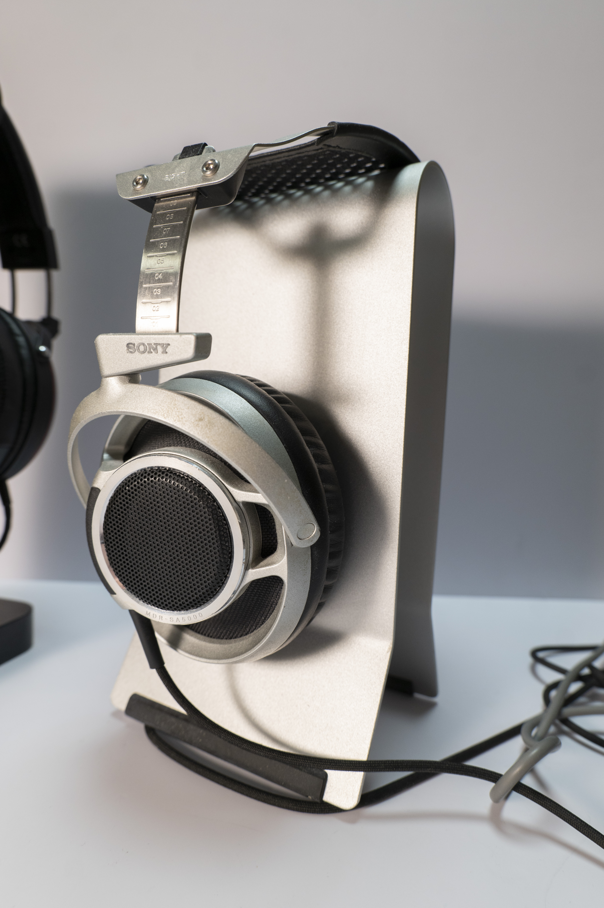

# Sony MDR-SA5000 声音测评

> 一句话听感：高频迅猛、瞬态极快，中频偏薄低频克制，是古典与电子乐的"手术刀"，不适合流行人声党

## 一、基础信息

| 项目 | 参数 |
| --- | --- |
| 型号 | Sony MDR-SA5000 |
| 类型 | 头戴式（开放式） |
| 单元 | 50mm 动圈 |
| 频响范围 | 5Hz–110kHz |
| 阻抗 | 70 Ω |
| 灵敏度 | 102 dB/mW |
| 前端 | 有线（6.3mm 单端，双入线可改平衡）|
| 参考售价 | 发售价 77,700 日元（约 8000+ 元国行）；现二手约 3000–4500 元 |

## 二、测试条件

- **前端**：prismsound lyra1
- **音源**：无损文件为主（FLAC / DSD，含 SACD 拍带）
- **音量**：常用听音档位中低音量，约 70–75 dB

## 三、三频表现

- **低频**：量感偏少，下潜一般，但速度是全场最大亮点——鼓点起音干脆、收放极快，毫无轰头感和拖尾，也不会掩蔽中频。属于"质感型"而非"氛围型"，低频量感党会嫌它太瘦。
- **中频**：干净、透明、结像清晰，但厚度和润泽感不足，明显偏薄。人声距离偏直白，亚洲女声（尤其纤细声线）恰到好处，欧美厚声男声则"差一口味道"。齿音偏多是需要接受的代价。
- **高频**：全耳机最大的看点。延展顶级、能量上扬，线条纤细锐利，小提琴松香味、三角铁余韵、镲片金属光泽层层扒开。不是"刺"，而是"快到不自然"，但部分录音会显得冷、硬、毛糙。

## 四、声场与解析

- **声场**：横向、纵向都不算大，高度感平平，与 HD800S 之类"声场狂魔"比输得较惨；声场形状略呈梯形，前方收窄，是比较奇怪的通病。
- **解析力**：顶级。细节密度大到"不自然"的程度，乐器分离度和定位精准度像用尺子量过，复杂编曲里每个声部都清清楚楚、互不干扰。
- **动态与瞬态**：瞬态是我听过的动圈里最快的一档，起音如闪电、收束无残响；大动态强弱对比清晰，听打击乐和快节奏电子乐"拳拳到肉又立刻收拳"。

## 五、音色与风格适配

- **整体音色**：偏冷、偏亮，声线纤细，透明度极高但不算"正"，明显不是监听流——它把声音刻意拉亮、拉快，是一把偏科严重的技术流手术刀。
- **适合**：古典（尤其室内乐、小编制）、电子乐、爵士、亚洲女声、器乐光泽感表现。
- **不适合**：流行人声、摇滚、Heavy bass、想要"杂食一锅端"调音的玩家；低频量感党与轰头党请直接绕行。

## 六、典型曲目听感

| 曲目 | 类型 | 听感记录 |
| --- | --- | --- |
| Eagles - Hotel California (Hell Freezes Over 现场版) | 人声/流行 | 沙锤和 Audience 泛音纤毫毕现，但人声偏薄、齿音明显，整体不如暖声耳机耐听 |
| 穆特《卡门幻想曲》 | 古典 | 弦乐光泽感和线条感是享受，弓弦摩擦细节层层展开，高频快到"不自然"但不过分刺耳 |
| Mickey Hart - Planet Drum | 打击乐/世界音乐 | 鼓皮起音的"snap"感一绝，收放干净利落，鼓组间的空间混响细节清晰可闻，是它最对味的曲目类型 |
| Daft Punk - Tron: Legacy OST | 电子 | 低频滚降迅猛、节奏骨架干净，合成器层次分明，电子乐几乎是为它的瞬态量身定做 |

## 七、声音优缺点

**优点**

- 瞬态速度和细节密度顶级，"最快动圈"名不虚传
- 高频延展与乐器光泽感至今未被超越
- 解析与乐器分离度、定位精准度属于历史级
- 低频干净不轰头，完全不掩蔽中高频

**缺点**

- 中频偏薄，齿音多，听流行人声不耐听
- 声场偏小，空间感与边界感一般
- 挑前端，冷声设备直推高频毛糙劝退

## 八、声音评分

| 维度 | 得分（满分 5） |
| --- | --- |
| 低频 | ★★★☆☆ |
| 中频 | ★★★☆☆ |
| 高频 | ★★★★★ |
| 声场 | ★★★☆☆ |
| 解析 | ★★★★★ |
| 动态瞬态 | ★★★★★ |
| **综合听感** | **★★★★☆** |

---
*测评基于prismsound lyra1声卡、FLAC/DSD 无损音源；听感因人而异，仅供参考。*
