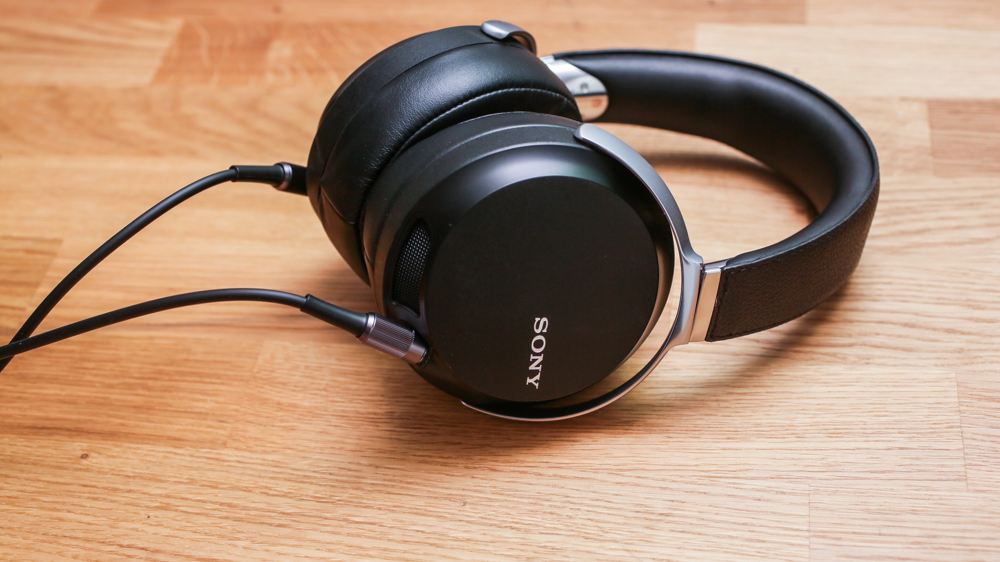

# Sony MDR-Z7（一代）声音测评

> 一句话听感：中低频厚实 Q 弹、声场像一套 2.1 声道影院，但高频偏暗、腔体带着甩不掉的山洞音——听感优先、素质妥协的"索尼味"封闭大耳

*图：Sony MDR-Z7，双 3.5mm 入线与金属悬挂结构清晰可见（摄影：Sarah Tew / CNET）*

## 一、基础信息

| 项目 | 参数 |
| --- | --- |
| 型号 | Sony MDR-Z7（2014 初代，非 Z7M2） |
| 类型 | 头戴式（封闭式，腔体上下开有通气格栅） |
| 单元 | 70mm 圆顶型动圈（CCAW 音圈，镀铝液晶高分子振膜） |
| 频响范围 | 4Hz–100kHz |
| 阻抗 | 70 Ω（1kHz） |
| 灵敏度 | 102 dB/mW |
| 最大承受功率 | 2000 mW |
| 重量 | 约 335 g（不含线） |
| 前端 | 有线，双 3.5mm 入线（螺纹锁固），支持平衡 |
| 附件 | 3m 镀银 OFC 单端线、2m 双 3.5mm 平衡线、6.3mm 转接头 |
| 参考售价 | 国行首发 3499 元（美版 $699 / 台版 20,900 新台币）；现二手约 1000–1800 元，成色与是否含升级线差异很大 |

Z7 是索尼 2014 年 9 月 4 日发布、11 月国内上市的民用旗舰，日本制造。它出现的时间点很关键：索尼刚把 Hi-Res Audio 定成全线战略，Z7 就是"给 Hi-Res 数字文件做一条配套大耳"的产物。这个出身，几乎决定了它后来所有的争议。

## 二、测试条件

- **前端**：prismsound lyra1（单端 / 平衡双路）
- **对照前端**：索尼 PHA-3 官方西装（平衡）、便携播放器直推
- **音源**：无损文件为主（FLAC / DSD）
- **音量**：常用听音档位中低音量，约 70–75 dB

## 三、三频表现

- **低频**：全耳机最鲜明的标签，也是最容易翻车的地方。量感明显偏多，但不是平铺的"肥"，而是集中在中低频上段做了一个**能量堆积**，听感上像给整套系统挂了一只独立低音炮——论坛里有人形容"能感觉到空气从格栅排出来"，这个描述很准。好处是 Q 弹、有冲击力，鼓点砸下去有质感和气浪感；坏处是极低频下潜其实一般，4Hz 那个数字纯属纸面参数。前端控制力不够时会立刻"油乎乎、闷乎乎、一大团一大团"，直接把中高频吃掉。
- **中频**：饱满、厚实、密度足，人声带磁性，换气、转音这些细微变化抓得很清楚，萨克斯和女声尤其有感染力。问题是**表情过于统一**——不管什么曲子，它都用同一种温暖、松弛、微带甜味的语气讲完，遇到需要转折和克制的段落就显得千篇一律，缺一点刚性。这也是一部分老烧说它"人声有点怪"的根源。
- **高频**：绕不过去的短板。延伸不足，能量在某个高度之后就快速衰减，线条偏细、密度偏少，听起来"清丽但发飘"，泛音和空气感都被掐掉一截。结果就是中低频那么厚、高频那么薄，两端不成比例。想要小提琴擦弦的缤纷细节、口水声和齿音细节的，这条耳机给不了。

## 四、声场与解析

- **声场**：横向量感不小，甚至接近半开放耳机的宽度，但**边界模糊**——不是那种能"看见"舞台边缘的清晰声场，而是一团往外散的空间。纵深做得不错，人声定位大约在正前方，低频则有一种从更远处独立传来的错觉，这也是"2.1 声道影院"这个比喻的由来。换上平衡线后声场会再打开一圈，层次更分明。
- **解析力**：细节量充足，但呈现方式很"索尼"——不是显微镜式的硬解析，而是让人**轻松地听到很多细节**。乐器分离度和定位在同价位封闭耳机里属于第一梯队，复杂编曲不会糊成一锅。
- **瞬态**：70mm 的大口径居然没有拖慢它，收放干净、节拍清晰，这点要服索尼的振膜和通气设计。当然它和 SA5000 那种"闪电型"瞬态不是一个路数，Z7 的快是"有重量感的快"。
- **山洞音**：必须单列。封闭腔体加上下通气格栅的结构，让它带上了一层轻微的隧道感/桶音，人声像是被裹在一个大房间里唱。原版耳罩下这个问题比较明显，换天鹅绒耳罩或做 MOD 后会大幅缓解。

## 五、音色与风格适配

- **整体音色**：中性偏暖，中下盘。金字塔型分布，重心明显压在低频。它不追求准确，追求的是"好听、有气氛、能坐得住"。
- **适合**：流行人声、R&B、爵士（尤其萨克斯）、电子与 ACG、电影与游戏、New Age。喜欢"动次打次"和氛围包裹感的人会很喜欢。
- **不适合**：古典大编制（低频一来整个乐队就变形，大提琴尤其明显）、需要表情刻画的严肃作品、死亡金属 / 哥特这类信息量爆炸的曲风，以及追求中性监听、需要拿耳机当参考工具的玩家。

**驱动这件事要说清楚**：102dB/mW 的灵敏度让它在手机上也能推出足够的音量，所以"直推能听"是真的；但 70mm 振膜对**控制力**的要求远高于对推力的要求，推力不足或输出阻抗不匹配时，低频立刻松散浑浊。它属于"好推响、难推好"的典型。官方的 PHA-3 平衡西装至今仍是最稳的搭配；上台式耳放时反而要避开高电压输出，否则整个声线会后缩。

## 六、典型曲目听感

| 曲目 | 类型 | 听感记录 |
| --- | --- | --- |
| 闫学敏《鼓诗》 | 打击乐 | 这条耳机的主场。鼓皮冲击带出真实的气浪感，低频一层层推过来，能听出鼓腔的形体，是同价位封闭耳机里少见的"推空气"体验 |
| Eagles - Hotel California (Hell Freezes Over 现场版) | 人声/流行 | 前奏的氛围和观众噪声铺得很满，人声厚实有磁性，但轮廓不够锐利，沙锤的金属质感被压平了一截 |
| 巴赫大键琴作品 / 大提琴独奏 | 古典 | 争议最大的一档。大键琴的颗粒感被低频烘托得发闷，大提琴一到低音区就开始扭曲，整体表情单一，很难听出巴洛克该有的克制与华贵 |
| Daft Punk - Tron: Legacy OST | 电子 | 合成器低频澎湃、节奏骨架清楚，影院感全开，是它最对味的类型之一；但极低频下潜的欠缺在这里也暴露得最明显 |
| 女声 / ACG 抒情曲 | 人声 | 中频饱满、齿音被柔化，久听不累；代价是歌手嗓音的细微表情被同一种"温柔"覆盖 |
| 电影原声 / 游戏 | 影音 | 它真正的舒适区。空间感、低频气势、长时间佩戴的舒适度三者叠加，比拿来听分析型音乐称职得多 |

## 七、声音优缺点

**优点**

- 中低频厚实 Q 弹，冲击力和氛围感在同价位封闭耳机里难找对手
- 声场横向开阔、纵深扎实，有接近半开放的听感，同时不漏音
- 人声饱满有磁性，细节丰富且久听不累
- 佩戴极其舒适，大耳罩全包耳，335g 重量分配合理
- 做工一流，全金属机身、日本制造，可换线 + 支持平衡，玩法多

**缺点**

- 高频偏暗、延伸不足、密度偏薄，与中低频厚度严重不匹配
- 腔体自带山洞音，人声有"桶味"，原版耳罩下尤其明显
- 中低频段人为能量堆积，极低频下潜名不副实
- 低频极度挑前端，控制力不足就糊成一团
- 表情单一，缺少刚性和起伏，难以胜任严肃古典
- 耳罩为皮质，夏天闷热，且老化的二手普遍有掉皮问题；隔音只防外漏不防内噪

## 八、声音评分

| 维度 | 得分（满分 5） |
| --- | --- |
| 低频 | ★★★★☆ |
| 中频 | ★★★★☆ |
| 高频 | ★★★☆☆ |
| 声场 | ★★★★☆ |
| 解析 | ★★★★☆ |
| 动态瞬态 | ★★★★☆ |
| **综合听感** | **★★★★☆** |

## 九、版本与玩法补充

Z7 一代在社区里其实有三个形态，听感差别不小：

- **原版（单端原线）**：就是上面写的声音。温和、厚、暗，安全但平庸，高频衔接处有明显不"索尼"的地方。
- **原版 + Kimber 等升级线 / 平衡驱动**：声场打开、低频收紧、层次分明，改善幅度比官方宣传的要实在，但仍改不掉高频偏暗的底子。
- **MOD 版（拆高音阻尼 + 天鹅绒耳罩 + 银线，俗称"金 Z7"）**：脱胎换骨。山洞音和高频暗这两个核心问题基本解决，素质直接跳到接近旗舰的水平，代价是调音转向 V 型，长时间听并不健康。论坛里有玩家拿它和 HD800、K812、Z1R 同场比较，认为硬素质已属同一档次——这条路径值得动手能力强的人尝试。

另外，2018 年的 **Z7M2** 是重新设计的另一条耳机（新振膜、新磁体、费波纳契框架、对称通气孔、4.4mm 平衡），走向更均衡、更精致、声场边界更清楚，但中低频那股蛮横的气浪感也一并被削掉了。想要"味道"选一代，想要"完成度"选二代。

---

*本文听感综合自耳机大家坛、耳机俱乐部等社区的一代实测与 MOD 讨论，并结合 prismsound lyra1 系统下的实际试听整理；听感因人而异，仅供参考。*
